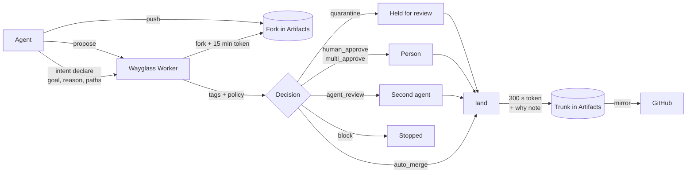

# Wayglass

[](https://github.com/wayglass/wayglass/actions/workflows/ci.yml)
[](go.mod)
[](https://developers.cloudflare.com/workers/)
[](https://developers.cloudflare.com/artifacts/)
[](LICENSE)

Zero Trust for agentic development.

Put coding agents to work in parallel under your policy.

You direct the work and set the policy. Agents declare what they intend to change and why. Wayglass classifies each proposal and applies your rules to determine whether it can proceed, needs review, or must be held or blocked. The intent, decision, and reason are recorded in an audit log, and `wayglass why` shows them for any line of landed code.

Trust is evaluated for each proposed change.

Your policy can let a documentation change land without review, require a person's approval for an authentication change, or quarantine a change it tags as personal data in an EU project.

> *We believe people should stay the authors of their software, even when agents
> write most of it. So every change carries its **"why"**, and every decision goes
> to whoever should make it: an agent when it's routine, a person when it matters.*

Wayglass is one Go binary (a CLI, a terminal UI, and `--json` for agents) and a
thin Cloudflare Worker. Each unit of agent work gets its own fork in
[Cloudflare Artifacts](https://developers.cloudflare.com/artifacts/) and a
short-lived token scoped to that fork. When the agent proposes its change, the
Worker tags it by area, data class, risk and jurisdiction, and a policy file
picks one action. Trust is decided per change, never granted per agent, the way
Cloudflare Gateway applies Allow, Block or Isolate to each class of traffic.

**Contents:** [How it works](#how-it-works) ·
[Policy](#policy) · [Quick start](#quick-start) ·
[Commands](#commands) · [For agents](#for-agents-json-and-exit-codes) ·
[Other ways to watch](#other-ways-to-watch) · [Status](#status) ·
[Measured run](#measured-run) · [Development](#development)

## How it works



1. An agent declares an intent: the goal, the paths it expects to touch, and the
   reason. The Worker forks the trunk for that intent and returns a write token
   for the fork only.
2. As agents push, the Worker compares declared and actual paths across all
   open intents and reports overlaps in the `--json` output.
3. `wayglass propose` classifies the change locally as a preview. The Worker
   reads the fork itself, re-derives the tags and makes the decision that
   counts, so a fork cannot relax its own rules.
4. The policy picks one action, and anything routed to a person waits for an
   approval with a written reason.
5. `wayglass land` merges the approved commit into the trunk with a 300-second
   token, attaches a git note with the intent and decision, and has the Worker
   verify that the trunk holds exactly the approved change.
6. Every step goes to an append-only audit log, so `wayglass why <file>:<line>`
   can answer "why is this here?"

## Policy

A policy is a YAML file at `.wayglass/policy.yaml`. Rules are checked top to
bottom and the first enforcing rule that matches decides. This is the example
policy that `wayglass init` writes, without its comments:

```yaml
version: 1
classify:
  area:
    docs: ["docs/**", "**/*.md"]
    web: ["web/**"]
    auth: ["**/auth/**", "**/login*"]
    infra: ["worker/wrangler.jsonc", ".github/**"]
  data_class:
    secrets:
      # The full file also matches AWS, GitHub, Anthropic, OpenAI, Slack, Stripe and Google keys.
      content: ["(?i)api[_-]?key", "art_v[0-9]+_([a-z]+_)?[0-9a-f]{40}", "-----BEGIN [A-Z ]*PRIVATE KEY-----"]
      paths: ["**/*.pem", "**/*.p12", "**/*.pfx", "**/*.key", "**/id_rsa", "**/id_ed25519", "**/.env"]
    pii: { content: ["(?i)\\bssn\\b", "(?i)date_of_birth"] }
  risk:
    high: { lines_changed_over: 400 }
rules:
  - { when: { data_class: secrets }, action: block, reason: "Secrets never land." }
  - { when: { area: infra }, action: multi_approve, approvers: 2, reason: "Infra changes affect everyone." }
  - { when: { area: auth }, action: human_approve, reason: "Auth is a security boundary." }
  - { when: { jurisdiction: eu, data_class: pii }, action: quarantine, reason: "EU personal data needs DPO review." }
  - { when: { only_area: docs, risk: low }, action: auto_merge, reason: "Routine docs change; every file is docs." }
  - { when: { risk: low }, action: agent_review, reason: "Low risk; second agent checks intent vs diff." }
default: { action: human_approve, reason: "No rule matched; a person decides." }
```

`area` matches when any changed file is in the area, so it suits strict rules.
`only_area` matches when every changed file is, so a docs edit cannot carry
code past review. Every area a rule names must be defined under
`classify.area`, or the file is refused. The commented file is
[`examples/policy.yaml`](examples/policy.yaml); `area`, `only_area`,
reviewer constraints and shadow mode are explained in
[docs/POLICY.md](docs/POLICY.md). To try a policy file against your recent
commits without contacting the Worker:

```bash
wayglass policy test --file examples/policy.yaml -n 20
```

| Action | What happens | `propose` exits |
|---|---|:-:|
| `auto_merge` | Approved by policy; the agent can land it | `0` |
| `agent_review` | A second agent checks the diff against the intent | `0` |
| `human_approve` | Waits for one person's approval | `4` |
| `multi_approve` | Waits for N distinct approvers (distinct keys: the admin key counts once, whatever name it gives) | `4` |
| `quarantine` | Held apart for review; nothing lands until someone other than the author approves it | `4` |
| `block` | Stopped; it can never be approved or landed | `3` |

A few guarantees hold whatever the policy says:

- Changes to `.wayglass/` edit the rules themselves, so a person always decides
  them (rule `builtin:protect-policy`).
- The agent that wrote a change cannot approve it.
- Jurisdiction comes from the namespace the project lives in, never from the
  client. A project made with `--jurisdiction eu` keeps its repos in an EU
  namespace and its Worker state (intents, decisions, audit log, sessions) in
  a Durable Object pinned to the EU, and its changes are tagged `eu`. Only
  the name-to-jurisdiction directory and the caller keys are global.
- A rule with `mode: shadow` is logged but not enforced, so a new rule can be
  watched before it takes effect. Each decision records the shadow rules that
  matched and whether they would have changed the action.
- A rule with `reviewer: { different_family: true }` needs an approver from
  another model family than the author (`claude`, `openai`, `gemini`, `meta`, `other`,
  `human`). The Worker refuses a same-family approval with `same_family`.
  Families are self-reported.

## Quick start

To evaluate Wayglass end to end (tests, offline checks, self-hosting, adversarial checks), follow [docs/EVALUATING.md](docs/EVALUATING.md).

### What you need

| | Version | Used for |
|---|---|---|
| Go | 1.25.8 or later | Building the CLI |
| git | 2.40 or later | Every command that touches a repo |
| Node.js + npm | 22.12 or later | The Worker, through the pinned `npx wrangler` in `worker/` |
| Cloudflare | Workers Paid | Self-hosting only; an existing Worker needs a Wayglass key |
| Bash, curl, openssl | | The self-hosting script |
| Bash, jq, curl | Bash 4 or later | The optional real-agent demo script |

### 1. Build the CLI

```bash
git clone https://github.com/wayglass/wayglass.git
cd wayglass
go build -o bin/wayglass ./cmd/wayglass
./bin/wayglass version
export PATH="$PWD/bin:$PATH"         # keep the built CLI available after changing directory
```

### 2. Look around without a Worker

Both terminal UIs can run on built-in sample data:

```bash
./bin/wayglass watch --demo-data     # the swarm: intents, tags, decisions, counters
./bin/wayglass review --demo-data    # the queue a person would review
```

Add `--json` to either one to see what an agent would get. The hosted Worker
at api.wayglass.dev serves no data to anonymous visitors: its web app sits
behind Cloudflare Access. To see the audit view in a browser, deploy your own
Worker (section 3 and [docs/SELF-HOSTING.md](docs/SELF-HOSTING.md)) and run
`wayglass init --public`.

### 3. Connect to a Worker

Every other command talks to a Wayglass Worker. Use one that already runs, or
deploy your own.

**Use an existing Worker.** Its admin mints you a key bound to your name
(`wayglass keys create --agent <you>`) and sends you the key and the Worker
URL. Set `KEY` in your shell without putting its value in shell history (for
example, `read -r -s KEY` in Bash), and replace the URL below. A person who
will review changes needs a human key (`wayglass keys create --agent <name> --human`), which the admin mints separately. Then:

```bash
printf %s "$KEY" | ./bin/wayglass login --worker "https://<worker-host>" --key-stdin
./bin/wayglass doctor
```

**Deploy your own.** You need a Cloudflare account on Workers Paid and an API
token with Artifacts, Workers Scripts and Queues edit rights. The script shows
its plan and asks before creating anything; `--dry-run` creates nothing.

```bash
export CLOUDFLARE_ACCOUNT_ID="<your account id>"
scripts/selfhost.sh --dry-run          # no API token needed for this check
# Before deploying, read the API token without saving it in shell history:
read -r -s CLOUDFLARE_API_TOKEN
export CLOUDFLARE_API_TOKEN
scripts/selfhost.sh                   # namespace, queue, deploy, login, doctor
```

It writes your settings to `worker/wrangler.selfhost.jsonc` (git-ignored), so
the committed `worker/wrangler.jsonc` stays untouched. Options (custom domain,
EU namespace, public audit view), push events and costs are in
[docs/SELF-HOSTING.md](docs/SELF-HOSTING.md).

To let people sign in with your organisation's login (Okta, Entra ID, Google
Workspace, GitHub, any OIDC or SAML provider, or a one-time PIN) instead of
keys, add `--domain <host> --access --allow 'you@example.com'`. The script
sets up Cloudflare Access for you; see
[People sign in through Cloudflare Access](docs/SELF-HOSTING.md#people-sign-in-through-cloudflare-access).

`wayglass doctor` checks git, your login, the Worker, your key, the project
and its trunk, and says what to fix. Add `--json` for agents.

### 4. Run the loop

Use a separate git repository for the project. Configure `git user.name` and
`git user.email` before running `init`; it creates a commit. Commit your
starting files first, since `init` pushes committed files only. Run
`wayglass agent setup` and commit its `AGENTS.md` before `init` if you want
agent instructions in that starting tree.

For a throwaway example after login:

```bash
mkdir "demo-test-stranger-$(date +%s)"
cd "$_"
git init -b main
# Set your own commit identity here if git does not already have it:
# git config user.name "Your Name"
# git config user.email "you@example.com"
wayglass agent setup
git add AGENTS.md
git commit -m "docs: teach agents how changes are reviewed"
wayglass init --public              # opt this example into the public audit view
wayglass intent declare --goal "Add a getting-started guide" \
  --reason "New users get lost after install" --path "docs/**"
mkdir -p docs
printf '# Getting started\n\nSign in before opening the app.\n' > docs/guide.md
wayglass push -m "docs: explain the sign-in prerequisite"
wayglass propose                   # the default policy approves this docs-only change
wayglass land                      # only after the decision is approved
wayglass why docs/guide.md:1
wayglass log --limit 20
```

For a change routed to a person (exit 4), that person signs in separately,
uses `wayglass clone <project>` to get a checkout, reads
`wayglass review --json` and `wayglass diff <intent-id>`, then runs
`wayglass approve <intent-id> --decision <decision-id> --reason "Checked session expiry and its tests"` or rejects it. Agent keys cannot decide person-routed
changes. Use the decision ID from the reviewed proposal; if the author
proposes again, reread the replacement before deciding. The author runs `wayglass land` once approval is complete. Skip
approval for an already-approved docs change.

> [!TIP]
> `wayglass init --jurisdiction eu` puts the project in the EU namespace. With
> the example policy, a change that stores a date of birth is then quarantined
> instead of reviewed.

> [!NOTE]
> Set `mirror: origin` in `.wayglass/config.yaml` and `land` pushes the trunk
> and its why notes to that remote.

### 5. Try it with real agents (optional)

[`examples/acme-shop/`](examples/acme-shop/) is a small Go web shop with eight
task briefs for Claude Code and Codex, each written to hit one route: docs
auto-merge, auth to a person, EU personal data quarantined, infra to two
people, tests to a reviewer from another model family, a hardcoded key
blocked, and two overlapping catalog changes stacked with `--on`.

```bash
scripts/demo/examples.sh             # two public demo-acme-* projects, one clone and launcher per task
```

It prints a launcher per agent and the person-routed changes to decide in
`wayglass review`. Details in
[examples/acme-shop/README.md](examples/acme-shop/README.md).

## Use Wayglass with an existing repository

`wayglass init` works in any git repository, history and all. Nothing is
rewritten: the repository's remotes stay, the trunk in Artifacts gets the
current branch's full history plus one commit that adds `.wayglass/`, and a
remote named `wayglass` points at the trunk for plain `git fetch`.

**A repository you already have checked out** (GitHub, GitLab, anywhere):

```bash
cd my-app                       # any branch checked out, dirty tree is fine
wayglass init                   # project named after the directory; --project to choose
wayglass init --tags            # push the tags too (off by default)
wayglass init --mirror origin   # and have `wayglass land` push each landed change to origin
```

**A repository you do not have yet.** `--from` clones it with your own git
credentials (your ssh-agent, your credential helper, `gh auth`), so private
repositories work and Wayglass never sees a GitHub credential:

```bash
wayglass init --from https://github.com/junegunn/fzf.git            # HTTPS
wayglass init --from git@github.com:you/private-app.git             # SSH
wayglass init --from ssh://git@gitlab.com/group/project.git app     # GitLab, into ./app
wayglass init --from https://git.example.com/team/repo.git --project repo --jurisdiction eu
```

The source stays as `origin`. The trunk branch is `main`; a clone whose
default branch is `master` is renamed locally to match, and an existing
checkout keeps its branch names (init says so). A URL with a password or
token in it, a `-`-prefixed value, `ext::`-style remote helpers and plain
`git://` or `http://` are refused; local paths need `--allow-local`.

Before creating anything, `init` checks what Artifacts would refuse: a file
over 32 MB anywhere in the history is named (`file_too_large`), and a detached
HEAD is refused (`detached_head`). Submodules travel as gitlinks and Git LFS
files as pointers; neither is fetched by the Worker.

**Publishing landed work back to GitHub.** Agents never push to origin. When
a change lands on the trunk, publish the trunk and its why-notes with your
own credentials:

```bash
wayglass publish                      # origin, the branch origin's HEAD points at
wayglass publish --remote github --branch master
```

`publish` never forces. If origin has commits the trunk lacks, it stops with
`publish_rejected`; bring them in through an intent like any other change:

```bash
wayglass intent declare --goal "Bring in upstream" --reason "Hotfixes landed on GitHub directly" --path "**"
git fetch origin && git merge origin/main
wayglass push -m "merge: upstream main" && wayglass propose && wayglass land
wayglass publish
```

With `mirror: origin` in `.wayglass/config.yaml` (`init --mirror origin`),
`land` publishes every landed change itself. GitHub and GitLab store the
notes ref but show it only through git:
`git fetch origin '+refs/notes/wayglass:refs/notes/wayglass' && git log`.

**Following an agent's fork** from your own machine:
`wayglass clone <project> --intent <id>` then plain `git pull`.

## Commands

| Command | What it does | |
|---|---|:-:|
| `login` | Stores the Worker URL and key (`~/.config/wayglass`, mode 0600); the key comes from stdin or `WAYGLASS_KEY`, never a flag | ✅ |
| `doctor` | Checks git, login, Worker, key, project and trunk; says what to fix | ✅ |
| `keys create` / `list` / `revoke` | Admin: per-agent keys bound to one name in the audit log | ✅ |
| `init` | Brings a repository under Wayglass: creates the project and its trunk from the current branch's history, writes `.wayglass/`, adds the `wayglass` remote (`--from <url>` clones first with your own git credentials; `--tags`, `--mirror origin`, `--jurisdiction us\|eu`, `--public`) | ✅ |
| `publish` | Pushes the landed trunk and `refs/notes/wayglass` to the repository's original remote with your own git credentials; never forces | ✅ |
| `agent setup` | Writes the Wayglass loop for coding agents into `AGENTS.md` (or `--file`); rerunning replaces only its block | ✅ |
| `intent declare` / `list` / `show` | Declares an intent and gets a fork (`--on` stacks it on another intent, `--family` records the model family); lists and shows them, with measured Artifacts cost | ✅ |
| `intent abandon` | Drops an intent with a reason; its fork tokens are revoked, the fork is kept, and intents stacked on it must propose again | 🧪 |
| `push` | Pushes to the intent's fork and reports changed files for overlap checks | ✅ |
| `overlaps` | Shows open intents whose paths overlap, with a suggested re-plan | ✅ |
| `propose` | Classifies the change; the Worker's policy decides (`--dry-run` decides locally only) | ✅ |
| `diff` | Shows an intent's change with a 300-second read-only token, for a reviewer | ✅ |
| `approve` / `reject` | Decides a change routed to you, with a required reason | ✅ |
| `land` | Merges an approved change into the trunk with its why, verifies it, then mirrors | ✅ |
| `sync` | In the intent's clone, merges the current trunk in with a 60-second read-only token (the recovery when `land` stops with `policy_changed` or `land_conflict`); then `push` and `propose` again | 🧪 |
| `clone <project> [dir]` | Checks out a project's trunk with its why-notes using a 60-second read-only token, ready for `review`, `land <intent-id>` and `why`; `--intent <id>` checks out that intent's fork instead, to follow an agent. Plain `git fetch` and `git pull` keep working through `git-credential` and keep the notes current; `git log` shows the why under each commit | ✅ |
| `git-credential` | Plumbing: the git credential helper `clone` configures per remote; mints a read-only token with your key on every `git fetch`, stores nothing | ✅ |
| `why <file>:<line>` | The intent, decision and reason behind a line | ✅ |
| `log` | The audit log (`--intent`, `--kind`, `--limit`, `--since`) | ✅ |
| `projects` (also `project list`) | Every project your key can read, across namespaces: jurisdiction, open intents, changes waiting for you, last activity; `--search` is matched by the Worker; `--json` adds the trunk remote, counts and the clone command | 🧪 |
| `watch` | The swarm at a glance: intents, tags, overlaps, decisions, counters (`--json --follow` for NDJSON); `p` or `--pick` opens the project picker | ✅ |
| `review` | The queue for a person; approve or reject with a reason (`--for agent` lists `agent_review` work; `p` or `--pick` switches project) | ✅ |
| `ai-review <intent-id>` | Has the Worker's AI reviewer decide an `agent_review` change: approve, or escalate to a person; off unless the Worker enables it | ✅ |
| `policy test` | Replays recent commits through a policy file, shadow rules included; offline | ✅ |
| `session share` / `fork` / `show` | Hands an intent's code and context to another person or agent, who continues in a new fork stacked on the original | ✅ |
| `version` | Prints the version | ✅ |

✅ verified against the live Worker or, for commands that never call it
(`agent setup`, `policy test`, `version`), run locally · 🧪 deployed and
covered by tests, no live run recorded yet. The [Status](#status) table says
where each one was checked.

## For agents: JSON and exit codes

Every command takes `--json`. With `--json`, or without a terminal, there is no
colour, no spinner and no prompt, so an agent never blocks on stdin. Output is
one versioned envelope:

```json
{"v":1,"ok":true,"data":{"intent":{"id":"i269d1c348e","status":"open"}}}
{"v":1,"ok":false,"error":{"code":"not_logged_in","message":"..."}}
```

A few errors also carry `error.details` with what an agent needs to recover;
`sync_conflict` lists the conflicting files there (`details.conflicts`).

| Exit code | Meaning |
|:-:|---|
| `0` | Command succeeded. After `propose`, check the decision status; `agent_review` can still be pending |
| `1` | Error |
| `2` | Usage error |
| `3` | Blocked by policy |
| `4` | A person must act |

Tokens stay out of files. Fork tokens live 15 minutes and land tokens 300
seconds, and both reach git only through `GIT_CONFIG_*` environment variables,
never through the URL, argv or `.git/config`.

## Other ways to watch

- **Plain git.** `wayglass clone <project>` (or `--intent <id>` for one
  agent's fork) leaves an ordinary checkout you can `git fetch`, `git pull`
  and `git log` in, today or next week, with no credential on disk. The
  clone sets, for that remote only, an empty `credential.<url>.helper` (so
  no inherited helper such as osxkeychain is ever offered a token) followed
  by `!wayglass git-credential --project <project>`, and git runs that on
  each fetch: it mints a read-only token with your stored Wayglass key
  (60 s for a trunk, 300 s for a fork; each mint is audited) and answers git
  on stdout. Nothing is stored, and the helper cannot push (Artifacts answers
  403); writes still go through `wayglass push` and `wayglass land`. When the
  key was revoked or the Worker is down the helper tells git to quit with
  the reason instead of asking for a password. Git's own traces keep the
  token out: `GIT_TRACE=1` logs only the helper command line, and
  `GIT_CURL_VERBOSE=1` and `GIT_TRACE_CURL=1` print `Authorization: Basic
  <redacted>`; only `GIT_TRACE_REDACT=0` shows it. `wayglass doctor` warns
  when a checkout's helper cannot run (for example, the binary moved).
- **Browse with any git tool.** The same clone keeps the why-notes current:
  `remote.origin.fetch` also carries `+refs/notes/wayglass*:refs/notes/wayglass*`,
  so every plain `git fetch` or `git pull` updates `refs/notes/wayglass`
  (and does not fail while a project has no notes yet), and
  `notes.displayRef` makes `git log` print the decision under each commit as
  `Notes (wayglass):` with the intent, matched rule, action and who decided.
  tig, lazygit, gitui and anything else that shows `git log` or `%N` shows
  it too; `wayglass why <file>:<line>` is the same note, checked against the
  Worker.
- **Public audit view.** The Worker serves a read-only page per project that
  opted in with `wayglass init --public`: counts, decisions by action, changes
  waiting for a person, Artifacts cost, and the audit timeline with reasons.
  JSON at `/v1/public/projects/<name>`, `/intents`, `/decisions`, `/audit`.
  A project that did not opt in answers 404. Anonymous reads are off on
  api.wayglass.dev (empty `PUBLIC_PROJECTS`, and the web app is behind
  Cloudflare Access); on your own Worker turn them on with `selfhost.sh
  --public`.
- **Web console** at `/console/` on your Worker, linked from the
  public view as "Sign in to review". Sign in with your key (kept for the
  browser tab only) to see the swarm, overlaps and the audit log, and to
  approve or reject changes routed to a person, with a required reason.
- **Desktop app** ([`desktop/`](desktop/), Wails v2, `make desktop`). The
  swarm, a Needs-you queue with approve and reject and a required reason,
  overlaps, the audit timeline and counters, using the CLI's login. See
  [desktop/README.md](desktop/README.md).
- **Project sites:** [wayglass.dev](https://wayglass.dev) and
  [docs.wayglass.dev](https://docs.wayglass.dev).

## Status

What is built and where it was checked. "Live" means run against the deployed
Worker at `https://api.wayglass.dev` and real Artifacts on October 13–14, 2026,
with nothing mocked. The numbers are under [Measured run](#measured-run).

| Feature | State | Where it was checked |
|---|---|---|
| 1. `init` creates the trunk in Artifacts | Built, live | `golden-path.sh`, project `demo-1791945963` |
| 2. Agents declare in parallel and get their own forks | Built, live | Same run, three agents at once |
| 3. `watch` shows intents and tags; an overlap is found and a re-plan suggested | Built, live; re-plans are suggested, not applied | Same run: `watch --json`, overlap `docs/** ~ docs/auth.md`, suggested `land_first` |
| 4. Docs auto-merge, EU personal data quarantined, auth to a person | Built, live | Same run, rules 4, 3 and 2; the PII change on EU project `eu-demo-1791797572` |
| 5. A person reviews and approves with a reason | Built, live | `review` TUI driven on a pty, project `demo-test-1791944907` (run log section 2) |
| 6. `wayglass why <file>:<line>` | Built, live | `why docs/getting-started.md:7`, and with the approver's reason on `demo-test-1791944907` |
| 7. `session fork <url>` on a second machine | Built, live | linux/arm64 container, `scripts/demo/second-machine/run.sh` (run log section 3). Since that run the fork is stacked on its source; that change is deployed and tested, with no live run recorded yet |
| 8. The website shows the audit trail | Built, live | On api.wayglass.dev to a person signed in through Cloudflare Access (the Worker refuses the web app without a valid Access token); on a self-hosted Worker also anonymously with `--public` |
| Land on a moved trunk, stacked intents (`--on`), conflict and abort | Built, live | `demo-test-1791944907` (run log section 2) |
| Shadow mode and `policy test` | Built, live | `demo-test-1791944907`: shadow line on every docs proposal; replay of 9 commits |
| `log` | Built, live | `demo-test-1791944907` |
| Reviewer from another model family, `diff` for reviewers | Built, live | Acme Shop dry run, `demo-test-acme-1791946483`: same-family approval refused, cross-family approved |
| Acme Shop example kit, 8 task briefs | Built, live with scripted stand-ins | 8 of 8 tasks routed as their brief says ([examples/acme-shop/README.md](examples/acme-shop/README.md)); no recorded run with real Claude Code and Codex sessions yet |
| Web console: approve or reject in the browser | Built, live | Approved `idffd1a23cb` on `demo-test-console-1791946613`, landed, and `why` showed the reason; placeholder reason refused |
| `intent abandon`, re-stacking children, stale intents | Built, deployed | Worker and CLI tests; no live run recorded yet |
| Artifacts cost per change (`intent show`, `watch`, web view) | Built, live | Measured run: 107 Worker-side binding calls |
| `doctor` | Built, live | All six checks pass against `api.wayglass.dev` |
| Existing repositories: `init` in a checkout, `init --from <url>`, `publish` | Built, live | Oct 14 on throwaway projects (deleted afterwards): `junegunn/fzf` (3,755 commits, 180 tags, default branch `master`) from a local clone and with `--from https://...` and `--tags` (40 s), `spf13/cobra` with `--from git@github.com:...` (SSH, 9 s) then a docs intent landed and `publish --remote` to a local bare remote (branch and notes arrived, no token in `.git`); a dirty tree and binary assets (cobra), a submodule gitlink and an LFS pointer (pushed as is); a 34 MB file refused as `file_too_large` naming the file and a detached HEAD refused as `detached_head`, both before any project existed; plain `git fetch wayglass` through the helper |
| `clone` with plain git afterwards (`git-credential`, notes follow) | Built, live | Oct 14 on `demo-1791938487`: `wayglass clone`, plain `git fetch` right away and again after the clone token expired, `git pull --ff-only`, `git ls-remote`; `git push` refused (403); `--intent i83f41dd279` fork clone, `git fetch` and `git pull`; `eu-demo-1791797572` (EU namespace, no notes yet) clone and fetch; a fetch brings `refs/notes/wayglass` back and `git log -3` shows `Notes (wayglass)` under each commit; no token in `.git`, in the macOS keychain or in `GIT_TRACE`/`GIT_CURL_VERBOSE`/`GIT_TRACE_CURL` output |
| AI reviewer for `agent_review` (`ai-review`) and advisory input | Built, live in manual mode | Oct 14: Workers AI approved a routine change, which landed with a Worker-verified why-note; injection escalated; auth review refused `needs_human`, and advice left the decision pending. Reproduce with `scripts/demo/ai-review.sh`. Other providers and automatic mode have local test coverage only |
| Per-agent keys (`keys`) | Built, live | The demo scripts mint one agent key per agent and revoke it on exit (Oct 13 runs: `golden-path.sh` 21/21, `examples.sh --standins` 10/10); an agent key trying to approve a change routed to a person gets `needs_human`, exit 4 |
| EU data residency for project state (`project migrate-residency`) | Built, tested on the Workers runtime; the live move of `eu-demo-1791797572` is pending | 18 Vitest cases in `worker/test/residency.test.ts`: an EU project's intents, decisions, audit log and push events land only in the EU-pinned Durable Object, a pre-move EU project is refused rather than served from the wrong place, and the move is verified, tombstones the old object and can be rerun |
| `agent setup` | Built | Local only (no Worker); a test checks the block against the real command tree |
| Desktop app | Built | Tested against a fake Worker; on Oct 14 a change was approved from the window on the live Worker, advice asked, and the author landed it; the card refreshes when the author proposes again (`2b8866d`) |
| Signed macOS builds | Built, verified locally | Oct 14: universal desktop app notarized and stapled; Gatekeeper accepts it and a quarantined copy opens. Both CLI architectures notarized; installer passes. Stable desktop signing requirement across two versions. [Release instructions](docs/RELEASING.md); CI signing secrets still need setup |
| `scripts/selfhost.sh` | Built, live | A fresh-account run on Oct 14 stopped at the queue step; fixed, then rerun on a brand-new account the same day: Tiers B and C of [docs/EVALUATING.md](docs/EVALUATING.md) passed, `--access` and `--uninstall` included. `scripts/test-selfhost.sh` (stubbed wrangler and curl, run in CI) covers a fresh account, a rerun, `--keep-key`, refused tokens, bad names, Access and `--uninstall` |

The AI reviewer has a per-project daily model-call budget (`AI_DAILY_REVIEWS`,
default 200) and a 60 KB diff cap. Hosted review is manual. See
[docs/POLICY.md](docs/POLICY.md) for provider and reviewer configuration.

Not built:

- Automatic re-planning. Overlaps come with a suggestion (`land_first`,
  `stack` or `split`); an agent or person acts on it.
- Short-lived agent session keys and project-scoped keys. Per-agent keys are
  bound to a name. People can sign in through Cloudflare Access for expiring
  human keys; admin verdicts share the identity `admin` and retain the supplied
  display name.
- Branch protection on the trunk. Artifacts has none, so the Worker detects a
  trunk push that skipped `land` but cannot prevent it.
- GitHub App sync. Planned, with the rest, in
  [docs/ROADMAP.md](docs/ROADMAP.md).

### Measured run

One run of [`scripts/demo/golden-path.sh`](scripts/demo/golden-path.sh)
against the deployed Worker and real Artifacts, finished October 13, 2026 at
19:46 PDT. Worker and CLI at revision `4ed499e`; projects `demo-1791945963`
(us, new trunk) and `eu-demo-1791797572` (eu, one new intent); 20 of 20
golden-path checks passed. **MEASURED** means timed or counted in this run
(counts from the Worker's audit log, times from the script's clock or the
Worker's event timestamps). **SCRIPTED** means the number is fixed by how the
script is written. Medians are over the three agents (n=3).

| Metric | Value | Label |
|---|---|---|
| Agents working in parallel | 3 | SCRIPTED |
| Agents in the audit log | 5 | MEASURED |
| Intents declared | 5 | MEASURED |
| Decisions | 3 | MEASURED |
| Decisions routed to auto_merge | 1 | MEASURED |
| Decisions routed to human_approve | 1 | MEASURED |
| Decisions routed to quarantine | 1 | MEASURED |
| Changes landed | 1 | MEASURED |
| Median push round-trip | 3034 ms (n=3) | MEASURED |
| Median propose round-trip | 1359 ms (n=3) | MEASURED |
| Median push-to-decision | 3611 ms (n=3) | MEASURED |
| Land round-trip | 5609 ms | MEASURED |
| Artifacts repos created | 6 | MEASURED |
| Repo tokens minted | 10 | MEASURED |
| Artifacts binding calls (Worker side) | 107 | MEASURED |
| Whole run | 45 s | MEASURED |

Push-to-decision includes a fixed 2 s pause the script makes before `propose`.
Only calls the Worker makes through the Artifacts binding are counted; git
traffic from agents straight to their forks is not. Re-run it with
`scripts/demo/golden-path.sh`, which prints the same table and says how each
number was taken.

## Repository layout

```text
cmd/wayglass/        the CLI entry point
cmd/policywasm/      the policy evaluator, compiled to Wasm for the Worker
internal/            cli, tui, api, gitx, intent, classify, policy, notes, audit
worker/              the Cloudflare Worker (TypeScript): API, Durable Objects, queue consumer
web/                 the public audit view (static, served by the Worker)
desktop/             the desktop app (Wails v2, its own Go module)
examples/            the example policy and the Acme Shop example kit
scripts/             selfhost.sh, and the demo harnesses under scripts/demo/
docs/                architecture decisions, policy, self-hosting, status and run logs
```

## Development

```bash
make            # format, vet, lint, test and build the CLI
make wasm-check # rebuild worker/src/wasm/policy.wasm and confirm it is reproducible
make desktop    # desktop tests, then wails build
cd worker && npx vitest run   # Worker tests
```

Policy and classification are the product, so both are covered by table-driven
tests, and the Worker runs the same Go evaluator as the CLI, compiled to Wasm.
Architecture decisions are recorded in
[`docs/ARCHITECTURE.md`](docs/ARCHITECTURE.md).

## License

[MIT](LICENSE)
